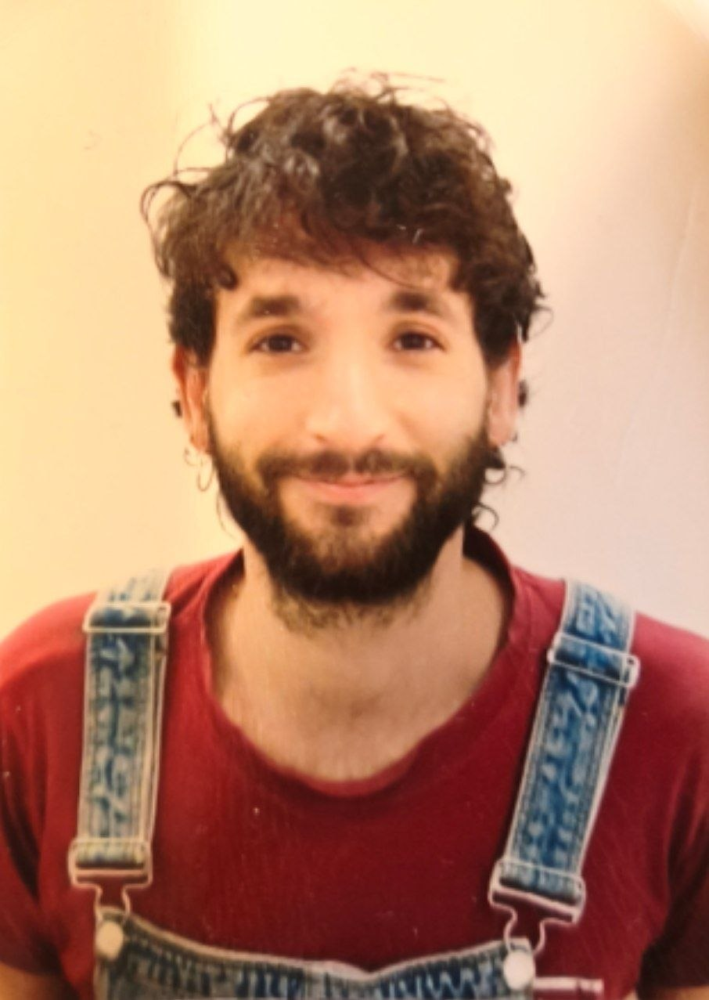
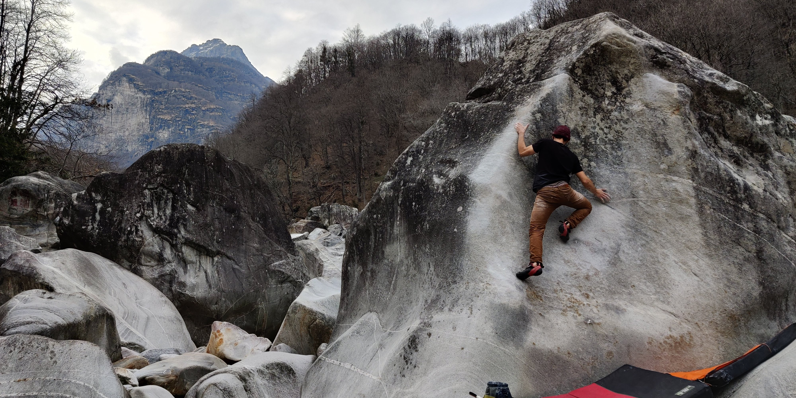
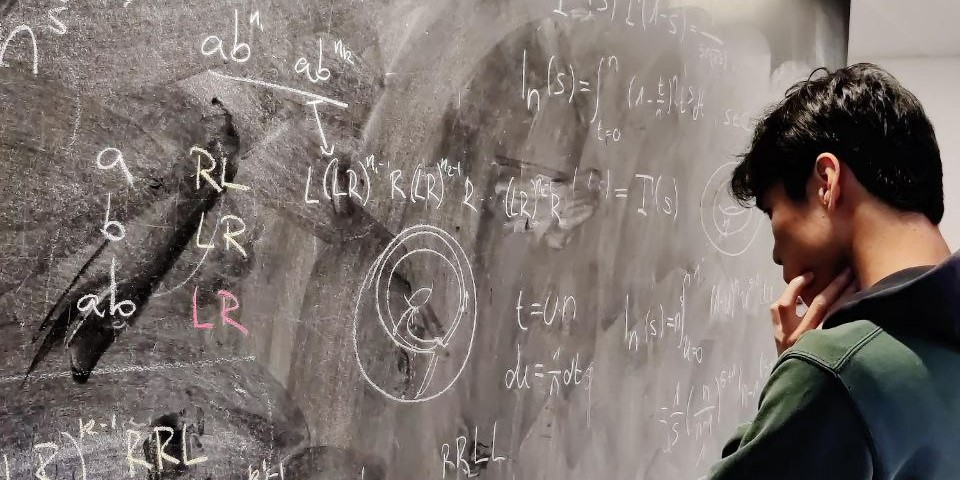
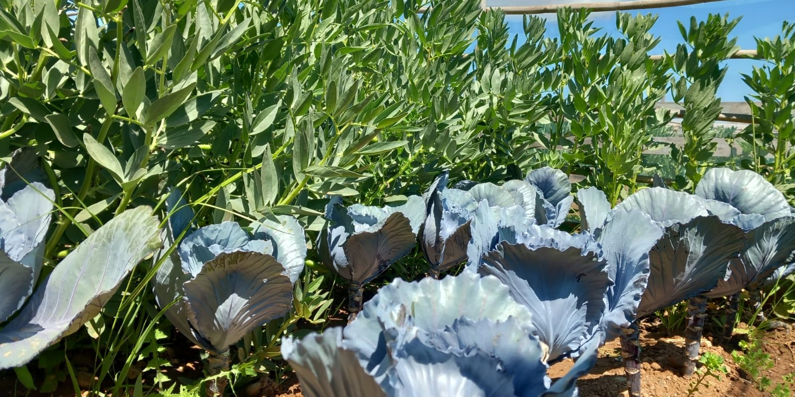
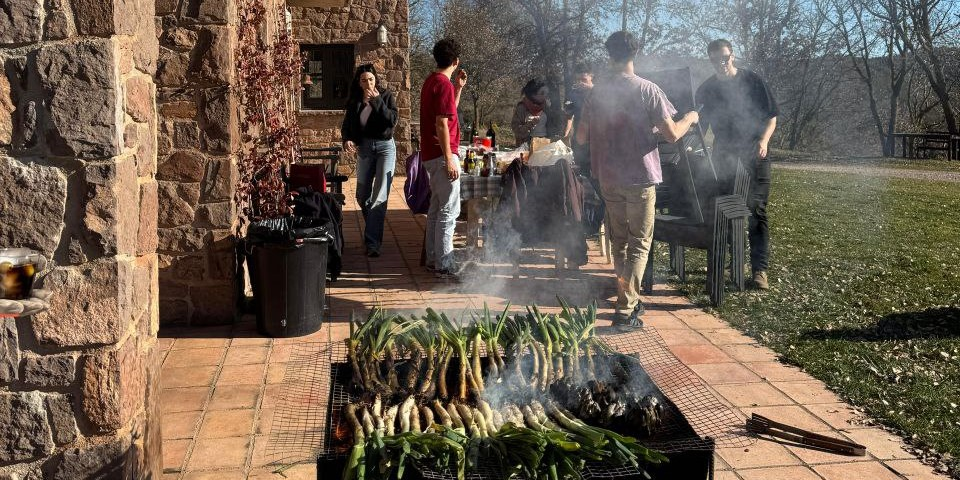
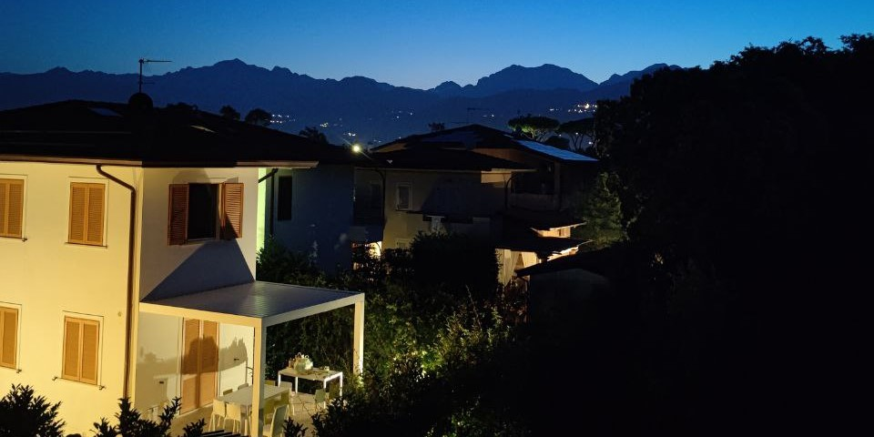

---
title: "Home"
permalink: "/"
layout: page
hide_title: true
---

  

    

      I am a postdoc at ETH Zürich in the group of <a href="https://yilwang.weebly.com/">Yilin Wang</a>.
    

    

      Before, I was a postdoc at Université Paris-Est Créteil,
      mentored by
      <a href="https://fanoni.perso.math.cnrs.fr/">Federica Fanoni</a>,
      and shortly a postdoc in this
      <a href="https://portalrecerca.uab.cat/en/projects/estructuras-y-desigualdades-geometricas-universales-2/">group</a>
      at Universitat Autònoma de Barcelona.
    

    

      In 2025, I obtained my PhD under the co-supervision of
      <a href="https://mat.uab.cat/~fbalacheff/">Florent Balacheff</a>
      at Universitat Autònoma de Barcelona and
      <a href="https://homeweb.unifr.ch/parlierh/pub/">Hugo Parlier</a>
      at the University of Luxembourg.
    

    

      Before, I completed my MSc in Pure Mathematics at
      Imperial College London under the supervision of
      Marie-Amélie Lawn.
    

    

      Here is my <a href="/CV.pdf">CV</a>.
    

  

  

    
  

Some of the things that help my existence are in the following pictures.

  

    
    
    
    
    
  

  <button id="prev-btn" style="position:absolute; top:50%; left:14px; transform:translateY(-50%); width:42px; height:42px; border-radius:999px; background:rgba(255,255,255,.82); backdrop-filter:blur(6px); border:none; cursor:pointer; font-size:18px; color:#0c8ea3; box-shadow:0 2px 10px rgba(0,0,0,.18);">❮</button>

  <button id="next-btn" style="position:absolute; top:50%; right:14px; transform:translateY(-50%); width:42px; height:42px; border-radius:999px; background:rgba(255,255,255,.82); backdrop-filter:blur(6px); border:none; cursor:pointer; font-size:18px; color:#0c8ea3; box-shadow:0 2px 10px rgba(0,0,0,.18);">❯</button>

# E-mail

d.fisac2@gmail.com
