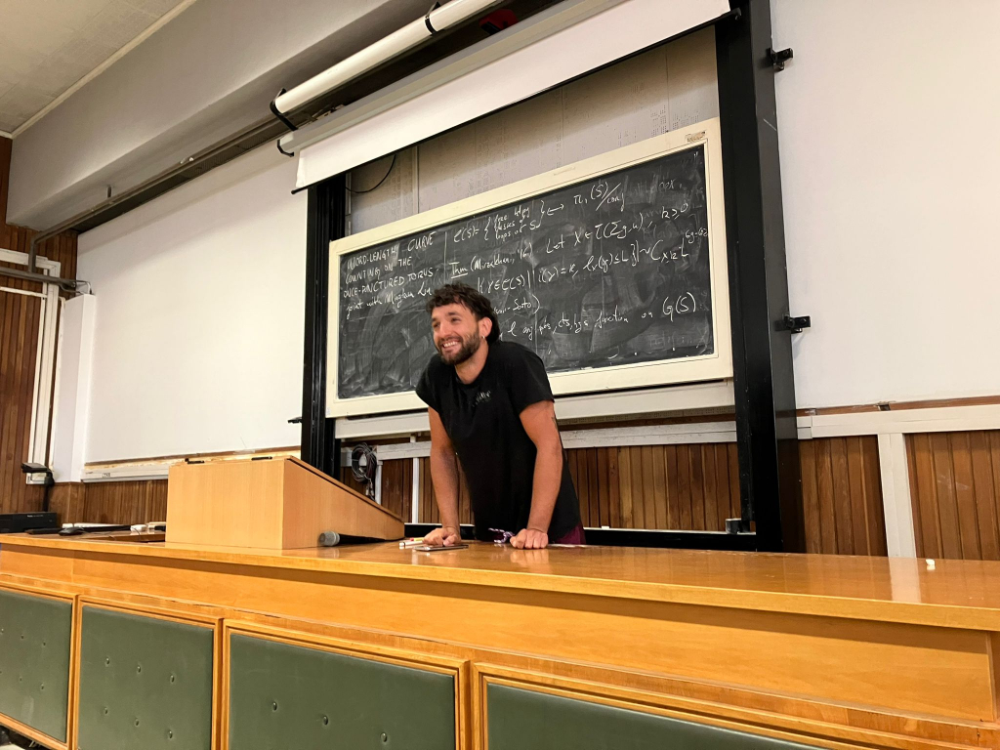

---
title: "Organization and Talks"
permalink: "/organization-talks/"
layout: page
---

# Organization

<a href="https://dfisac.github.io/chats">Curves, Hyperbolicity, And Teichmüller Spaces (CHATS)</a>

Organised with <a href="https://perso.math.u-pem.fr/long.yusen/index.html">Yusen Long</a>, a workshop on low-dimensional geometric topology, June 2026 at UPEC.

# Invited Talks

- **Seminari de geometria** at Universitat Autònoma de Barcelona, Nov 2026, Barcelona.
- **Recent developments in Teichmüler theory** at the MFO, Oct 2026, Oberwolfach, Germany.
- **Géométrie hyperbolique et surfaces, in honor of Greg McShane** at Université Grenoble Alpes, Sep 2026, Grenoble, France.
- **Curve counting: what's next?** at the Hamilton Mathematics Institute, May 2026, Dublin, Ireland.
- **Séminaire Géométrie et Topologie** at Institut de Mathématiques de Jussieu, May 2026, Paris, France.
- **Geometry and Spectra of Riemann Surfaces** (lightning) at EPFL, Apr 2026, Lausanne, Switzerland.
- **Geometry and Topology seminar**, Dec 2025, Luxembourg.
- **Geometry seminar** at MPI MiS, Jun 2025, Leipzig, Germany.
- **Mittagsseminar CADMO** at ETHZ, May 2025, Zurich, Switzerland.
- **Perspectives on Markov Numbers** (lightning), Jan 2025, BIRS, Banff, Canada.
- **Colloque de Géométrie**, Nov 2024, Université Paris-Est Créteil, France.
- **2nd International AMS-UMI Joint Meeting**, Jul 2024, Palermo, Sicily.
- **Surfaces, Manifolds and Related Topics (SMaRT)**, Mar 2024, Luxembourg.
- **Geometry Seminar** at Universitat Autònoma de Barcelona, Jan 2024, Barcelona.
- **Geometry, Probability and their Synergies**, Mar 2023, Les Diablerets, Switzerland.
- **VI Congreso de Jóvenes Investigadores de la RSME**, Feb 2023, León, Spain.

 

